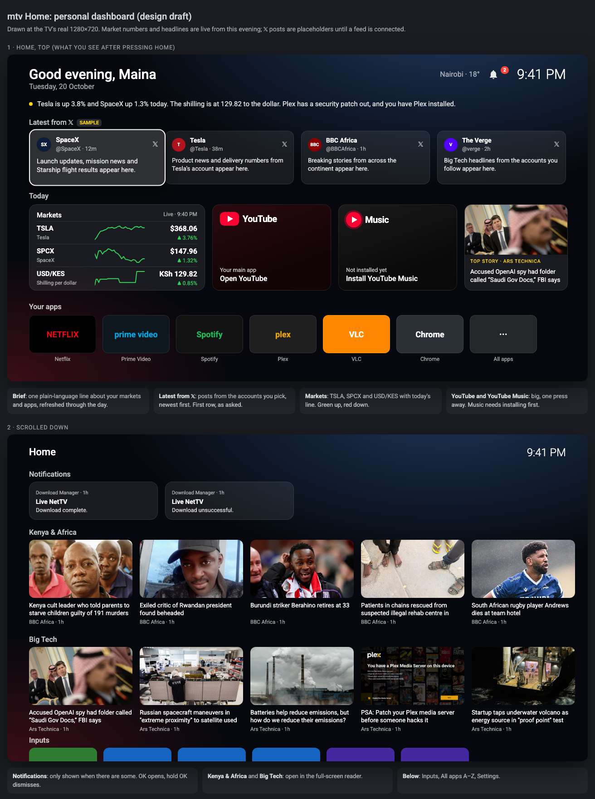

# mtv Home

A personal dashboard home screen for Android TV. Press HOME and you get your day at a glance:
a greeting, a plain-language brief, your stocks and currencies with live charts, YouTube one press
away, your apps, notifications and the news. Market moves pop up over whatever you're watching.



## Install (one command)

On the TV, once:

1. **Settings › System › About**: click **Build** seven times to unlock developer options.
2. **Settings › System › Developer options**: turn on **USB debugging** (and **Network debugging** if listed).
3. Keep the TV on the same Wi-Fi as your computer.

Then on a Mac or Linux computer:

```bash
curl -fsSL https://raw.githubusercontent.com/Themaina/mtv-home/main/install.sh | bash
```

The installer finds the TV, installs the latest release, asks your name, city and stocks, turns on
notifications and pop-up alerts, and makes mtv Home the home screen. Run the same command to update;
your settings are kept.

| Option | What it does |
|---|---|
| `--tv 192.168.1.20` | Skip the network scan |
| `--name Maina --city Nairobi --watchlist TSLA,SPCX,USDKES=X` | Answer the questions up front |
| `--no-launch` | Install without switching the TV's screen |
| `--uninstall` | Put the original home screen back and remove the app |

Pass options after `bash -s --`, for example `… | bash -s -- --tv 192.168.1.20`.

## What's on the dashboard

1. **Greeting and brief**: one line written like a person, e.g. *"Tesla is up 3.8% and SpaceX up 1.3% today.
   The shilling is at 129.82 to the dollar. US market closes in 45m."*
2. **Latest from 𝕏**: posts from feeds you add (see below). Hidden until you add one.
3. **Today**: markets with today's line, big YouTube and YouTube Music tiles, and the top story.
4. **Your apps**: most recently used first.
5. **Notifications**, **Top stories** (BBC, BBC Africa, Al Jazeera), **Big Tech** (The Verge, TechCrunch,
   Ars Technica), **Inputs**, **All apps** and **Settings**.

Stories open in a full-screen reader that pulls the article text, so you can read with the remote.

### Market alerts

A small banner appears in the top-right corner, over any app, when:

- a stock's move for the day crosses another 2% step (2%, 4%, 6%…, up or down);
- a currency moves another 0.5%;
- the US market opens or closes, with a one-line summary.

It never takes focus, so the remote keeps controlling what you're watching. Quotes come from Yahoo
Finance's public charts, every minute around US trading hours and every 10 minutes otherwise.
Symbols use Yahoo's format: `TSLA`, `SPCX`, `AAPL`, `USDKES=X`, `EURUSD=X`, `BTC-USD`.

### Personalize

**Settings row › Personalize** edits your name, city, watchlist, alert steps, 𝕏 feeds, and whether the
dashboard opens when the TV starts.

**𝕏 posts**: X no longer offers free feeds. Paste RSS links from an X-to-RSS service (for example
rss.app or a self-hosted RSSHub) into the 𝕏 feeds box, one per line.

## Works best on

Android TV / Google TV, Android 8 or newer. Built and tested on a Toptech TV (Realtek RTD2851A,
Android 11, 1 GB RAM), where it also switches HDMI and antenna inputs directly. On other TVs, inputs
open through the standard Android TV live-TV app if one is installed.

Some TVs re-open the last input on power-up; mtv Home brings itself to the front a few seconds later.
Turn that off in Personalize if you'd rather keep the TV's behaviour.

## Develop

Requirements: Android SDK (platform 35, build-tools 34+), JDK 17.

```bash
./gradlew :launcher:assembleRelease                 # build
./gradlew :launcher:testReleaseUnitTest             # unit tests
./gradlew :launcher:testReleaseUnitTest -Plive      # also hit the real news and market feeds
TV_ADDR=192.168.1.20 scripts/launcher.sh --no-launch  # build and install on your TV
```

Release builds are signed with the key described in `~/.mtv/keystore.properties` (not in this repo).
Without it, builds use the debug key.

| Path | What |
|---|---|
| `launcher/` | The dashboard app (`com.mtv.launcher`) |
| `launcher/.../market/` | Quotes, alert rules, background watcher, pop-up banner |
| `launcher/.../news/` | RSS/Atom parsing, article reader extraction |
| `launcher/.../config/` | Personal settings, and the installer's adb hook |
| `install.sh` | The one-command installer |
| `app/` | Hello-world sandbox used to prove the build pipeline |
| `docs/` | TV survey and the dashboard design |

### Toptech input switching

These TVs have no public intent for "switch to HDMI 2". The TV player chooses the source from the
intent action:

```bash
adb shell am start -n com.toptech.tvmenu/.TvActivity -a com.toptech.tv.ACTION_HDMI_2
```

Known actions (prefix `com.toptech.tv.`): `ACTION_TV`, `ACTION_HDMI_1..3`, `ACTION_AV`, `ACTION_YPBPR`,
`ACTION_DTV`, `ACTION_ATV`, `ACTION_DVBT/C/S`, `ACTION_ATSC`, `ACTION_ISDB`, `ACTION_VGA`, `ACTION_SCART`.

### Bluetooth on cheap TVs

Some budget TVs advertise Bluetooth but ship without the radio or Android's Bluetooth service. If your
TV supports USB audio, a USB Bluetooth audio transmitter that shows up as a sound card is the
workaround: it pairs with the speaker itself.
